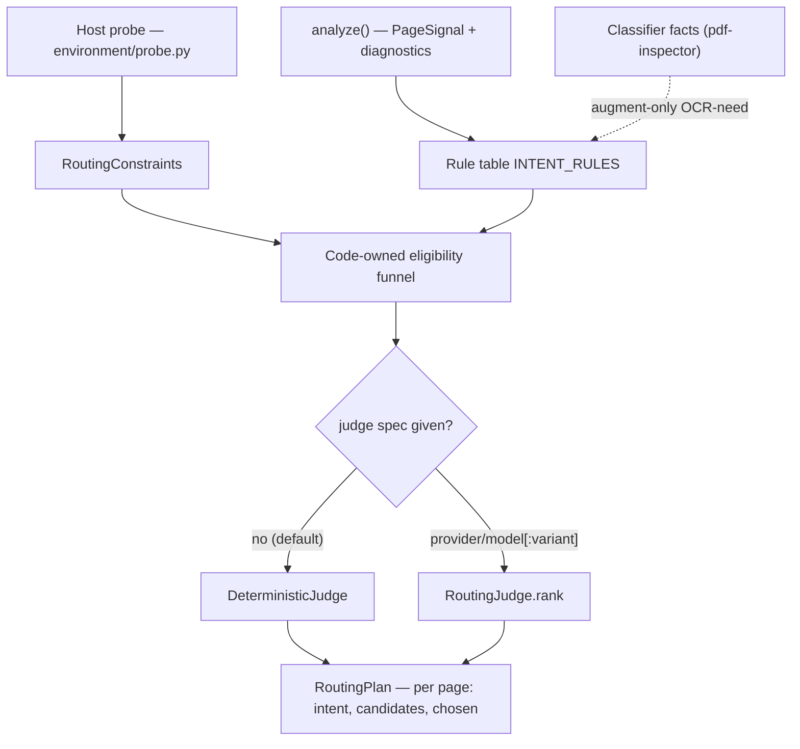

Auto mode is the default path of `parsecraft convert`: analyze first, decide
per page, then convert. The decision consumes four inputs — the host probe, a
fast complexity analysis, the deterministic rule table, and an optional
LLM-backed seam — and produces a `RoutingPlan` before any backend runs. This
page explains what each input contributes today and which knobs tune the
outcome. Stage-by-stage mechanics live in
[Routing and auto mode](routing.md).

Status labels used below: **current** (shipped and reachable today) and
**planned** (agreed direction, nothing built).



## Hardware inputs

**Status:** current, except where marked planned.

Each CLI invocation probes the host once (`probe_environment()` in
`src/parsecraft/environment/probe.py`) and bridges the result into
`RoutingConstraints` (`constraints_from_environment()` in
`src/parsecraft/environment/constraints.py`):

| Input | How it is detected | How routing uses it |
| --- | --- | --- |
| Installed extras | `EXTRA_IMPORTS` map + `importlib.util.find_spec` — locates, never imports | `installed_extras`; a candidate whose `optional_dependency_group` is not installed is ineligible |
| GPU / VRAM budget | bounded `nvidia-smi --query-gpu=memory.total` call (10 s timeout, first GPU only; missing, failing, or malformed output → `0.0`) plus a metadata read of the installed torch build's CUDA support | `vram_budget_gb` and `gpu_usable`; a backend needing a GPU survives only when the runtime can use one and its declared estimate fits the measured budget |
| Offline state | `PARSECRAFT_OFFLINE`, operator-declared — connectivity is never probed | `offline`; excludes backends carrying a `model_asset` |
| OCR permission | derived from detected `ocr-*` extras; `--no-ocr` overrides | `allow_ocr`; when off, OCR intents may only degrade to native |
| Source formats | suffix → MIME via `MEDIA_TYPES` (`src/parsecraft/pipeline/analysis.py`) | `formats`; a candidate must cover every source MIME |
| Language (BCP-47) | caller-supplied, never derived | `language`; narrows only backends that *declare* `capabilities.languages` |

**CPU/GPU split.** Each descriptor declares `gpu_requirement`, a soft score from
`0.0` to `1.0` (`src/parsecraft/backends/protocol.py`): `GPU_NOT_NEEDED` (0.0) when
a GPU changes nothing, `GPU_OPTIONAL` (0.5) when it is a speedup rather than a
precondition, `GPU_REQUIRED` (1.0) when the backend must not run on CPU.
`is_hard_eligible()` (`src/parsecraft/routing/rules.py`) hard-gates only the last
one, and only when the host has both a usable runtime (`gpu_usable`) and room
(`estimated_vram_gb <= vram_budget_gb`). The middle values inform ranking and the
judge's request state; a CPU-capable backend stays eligible without a GPU,
because a slow answer beats no answer.

Hardware presence and runtime capability are separate facts. A machine can report
8 GiB through `nvidia-smi` while its torch is a `+cpu` build (`torch.cuda.is_available()`
is `False`): without `gpu_usable` the planner would admit a GPU-only backend that
then generates token-by-token on the CPU. When that happens the CLI says so once
on stderr (`GPU detected but unusable: … — GPU-only backends are excluded`) and a
backend that declares `GPU_REQUIRED` also refuses a silent CPU placement at load
time (a typed failure the plan can fall back from).

Routing itself never probes hardware: descriptors *declare* what a backend can
do, the probe *detects* what this host has, and the planner reads both as plain
data.

**Deferred, not planned:** RAM and disk-speed probing were designed (2026-10-01)
and intentionally not built. Nothing consumes them: no backend declares a RAM
floor, so a probe would feed a field no rule reads. RAM probing has a written
design and a trigger — a registered backend declares a RAM floor that
eligibility actually checks. Disk-speed probing is rejected as a routing
input: it is a runtime side effect (I/O load, cache pollution) and cannot
yield honest cold-start numbers in-process; disk *capacity* is already
enforced where it matters (`InsufficientDiskSpaceError` before model
downloads). `EnvironmentInfo` carries only `backends`, `installed_extras`,
`vram_budget_gb`, and `offline`, and `RoutingConstraints` has no field that
could carry a RAM or disk figure.

## Fast complexity analysis

### What runs today

**Status:** current.

`analyze_source()` chooses the analyzer with `choose_analyzer()`
(`src/parsecraft/pipeline/analysis.py`): native backends first, then name
order, extras-aware. `DocumentBackend.analyze()` then produces an
`AnalysisResult` — source hash, page count, per-page signals, document
diagnostics — without converting any content.

Each `PageSignal` (`src/parsecraft/ir/models.py`) carries:

| Field | Meaning |
| --- | --- |
| `page_number` | 1-based page index |
| `has_native_text` | the page has extractable native text |
| `text_chars` | native text characters on the page |
| `image_count` | images on the page |
| `blank` | no content at all |
| `replacement_char_ratio` | share of U+FFFD garbage in the native text (`None` when not measured) |

`page_needs_ocr()` (`src/parsecraft/routing/rules.py`) is true when the page
is blank, has no native text, has fewer than `NATIVE_MIN_TEXT_CHARS` text
characters, or exceeds `MAX_REPLACEMENT_RATIO` replacement characters. The
thresholds are code-owned constants:

| Constant | Value | Effect |
| --- | --- | --- |
| `NATIVE_MIN_TEXT_CHARS` | 40 | thin pages route to OCR |
| `MAX_REPLACEMENT_RATIO` | 0.05 | garbled pages route to OCR |
| `HEAVY_IMAGE_COUNT` | 5 | document image mass ≥ 5 sets the figures hint |

Document-level flavor comes from `extract_hints()`: the diagnostic codes
`feature:tables`, `feature:equations`, `feature:figures`, plus image mass for
the figures hint. The rule table (`INTENT_RULES`) then selects the OCR flavor —
tables hint on a multi-page document → `OCR_TABLES`, equations/figures →
`OCR_VISION`, otherwise `OCR_GENERAL`.

**The hint channel is under-fed in production.** No production backend emits a
`feature:*` code; `pymupdf` is the only analyzer that emits analysis
diagnostics at all (`pdf-encrypted`, `pdf-no-extractable-text` — neither is a
feature hint), and the `feature:*` codes are synthesized only by tests. Real
documents therefore route on text statistics and image mass alone.

### Structural classifier facts

**Status:** current.

The second optional seam beside the judge is
`detect_pdf` from the `pdf-inspector` extra: it reports
`pdf_type`, `confidence`, `pages_needing_ocr`, `pages_with_tables`, and
machine-readable OCR reasons. A pure fold (`apply_classifier()` in
`src/parsecraft/pipeline/analysis.py`) merges them at the analysis boundary;
`plan_route` keeps its signature and stays pure.

The merge is augment-only and asymmetric:
`OCR-need = page_needs_ocr(signal) OR (signal.classifier_needs_ocr is True)`.
The classifier may add OCR-need, never remove it — a `text_based` verdict never
forces `NATIVE` on a page whose native text genuinely fails. With no classifier
or on classifier error, classification is exactly today's rule table; absence
*is* the current behavior. The fold also emits a provenance diagnostic
(classifier name, upstream version, `pdf_type`, confidence) and fills
`feature:tables` from real table pages.

### Classifier cost profile

The classifier is a pure-Rust **text-layer structural scan**, tens of
milliseconds (≈20–100 ms), and loads **no models** — detection only. It runs
inside `analyze()` before any conversion is chosen, so its cost stays
negligible against the work it routes: native conversions cost ~ms–s and
docling/OCR conversions s–min. A classifier that loads an ML model to decide
whether to run an ML backend is out of contract, so the answer to "isn't using ML to decide about ML oversized?"
is no — the decision is a scan, not a model.

### Language and domain slang

**Status:** seam without a shipped provider; planned extension.

`LanguageDetector` (`src/parsecraft/routing/language.py`) is an injectable
protocol: the core only reads `RoutingConstraints.language` as plain data and
never imports a detector — callers implement the protocol or set the
constraint directly from configuration. The request narrows only backends that
declare `capabilities.languages`; language-agnostic candidates are never
excluded.

**Planned:** a shipped detector implementation, and domain or slang analysis
beyond it — no design or code exists for either.

## Hybrid per-page routing

**Status:** current — routing already operates per page at every stage.

- **Per-page intent.** `classify_page()` applies the single `INTENT_RULES`
  table to every `PageSignal` in page order; each page gets its own `Intent`
  (`NATIVE`, `OCR_GENERAL`, `OCR_TABLES`, `OCR_VISION`).
- **Per-page pass list.** Every `PageRoute` carries its own
  `candidates` list capped at `max_passes`, with `chosen = candidates[0]` and a
  human-readable `reason`. `RoutingPlan.primary` is the
  most-chosen backend across pages, tie-broken by name.
- **Code-owned eligibility.** Installed extras, VRAM budget, format coverage,
  `allow_ocr`, offline, language, and the intent family are filtered before any
  judge runs; a judge only re-ranks and can never widen the set — an
  ineligible, duplicate, or empty order raises `JudgeViolationError`.
- **Ranking preference.** `RoutingConstraints.preference` (`speed` | `balanced`
  | `quality`, default `balanced`) is a *ranking* axis, never a filter: it
  reorders candidates inside the family the rules already chose and cannot move
  one across a family boundary (a big OCR model never overtakes the native lead
  for a native page). `DeterministicJudge` reads it as the VRAM direction — a
  proxy for model strength, not a measurement, so an undeclared size sorts last
  in both directions — and the System One judge templates carry it into the
  Choice question, both in `state.preference` and in the instruction text, so an
  LLM judge actually weighs it. One `--preference` flag drives both the
  planner's own judge (via the constraints) and a resolved provider (via
  `resolve_judge`).
- **Degradation mirror.** When an OCR-intent page finds no eligible OCR
  backend but still has native text, `plan_route` degrades it to `NATIVE` with
  a recorded reason and a `degraded-garbled-text` /
  `degraded-short-text` quality signal; genuinely blank pages keep raising
  `NoEligibleBackendError`, and a native-intent page is never silently routed
  to OCR.
- **Execution follows the plan.** `src/parsecraft/pipeline/executor.py` merges
  *contiguous* pages into one range only when they share
  `(intent, chosen, candidates)` and the backend declares
  `supports_page_ranges` and `supports_multi_page`; otherwise the page dispatches
  alone. Fallback candidates run in plan order on typed failure, one backend
  instance at a time, and total exhaustion is loud
  (`pipeline-all-passes-failed` warning, `winner=None`).

Grouping is an execution optimization only: the plan, the reasons, and the
fallback lists stay per page throughout.

## LLM access

The rule behind this section: **a no-heuristic LLM path
must be configurable**, and the heuristic path remains the default whenever no
spec is given.

Neither seam is gated by `RoutingConstraints.offline`: that flag excludes
model-asset **backends** from candidacy and never blocks a provider
the caller named explicitly. A judge spec is the opt-in — judges may reach the
network (`typesafe-ai/jev-latest` does) — while classifiers stay local-only by A4. No
provider is resolved at all unless a spec is given, so an offline-declared run
with no `--judge`/`--classifier` never leaves the process.

### Judge spec — ordering

**Status:** current, at library and CLI level.

`resolve_judge(spec)` (`src/parsecraft/routing/judge_providers.py`) accepts:

- `None` → `DeterministicJudge` (the unchanged default);
- a `RoutingJudge` instance → passthrough;
- a string → parsed as `provider/model[:variant]`
  (`parse_judge_spec` → `JudgeSpec`), then dispatched to a runtime-registered
  loader (`register_judge_provider`, last registration wins) or lazily
  imported from `parsecraft.providers.<provider>.load_judge(spec)` at resolve
  time only — never at module import, never inline.

Failures are typed: `JudgeSpecError` (malformed spec),
`JudgeProviderUnavailableError` (names the provider extra to install), and
`JudgeProviderLoadError` (loader failed or returned a non-judge). Three judge
providers ship, all System One endpoints sharing one implementation
(`src/parsecraft/providers/_jev.py`) — `typesafe-ai/jev-latest` (the TypeSafe
cloud serves `jev-latest`/`jev-preview`; a bare `jev` is unknown;
`TYPESAFE_API_KEY`), `zen/<model>` (OpenCode Zen, `OPENCODE_API_KEY`), and
`ollama/<model>` (a local daemon, no key).

CLI surface: `convert --backend NAME` leads every eligible page with `NAME`
through a CLI-owned `PreferredBackendJudge` (`--no-auto` requires `--backend`),
and `convert --judge SPEC` resolves the same spec strings here; auto mode with
neither flag uses `DeterministicJudge`. `--backend` and `--judge` are mutually
exclusive — both choose the lead candidate — a malformed spec exits `2`, and a
provider that cannot be loaded exits `1`.

#### What the decision model receives

The judge request carries **no document content** — only bounded, declared
facts. The state has four keys, and keys without a fact are omitted rather than
zero-filled:

- `intent` and `preference` — the page class and the axis the caller asked to
  optimise (`BALANCED`, `QUALITY`, `SPEED`).
- `candidates` — per candidate: `family`, the declared `tier` (0 native, 1
  intelligent parser, 2 OCR/VLM), `gpu_requirement`, `estimated_vram_gb` and
  `formats`. No prose, no names beyond the backend ids.
- `machine` — `vram_budget_gb` and `gpu_usable` (omitted entirely on an unknown
  host instead of a misleading zero).
- `page` and `hints` — the page class (`needs_ocr`, `blank`, `density`) and the
  document's structural hints. NATIVE pages carry a context too (`needs_ocr` is
  false there), which is what lets a judge reason about sparse-vs-dense native
  pages.

A shortened example (`mineru` and `ocr-ovis` on a GPU host, one dense native
page):

```json
{
  "intent": "native",
  "preference": "quality",
  "candidates": {
    "native-pdf": {"family": "native", "tier": 0, "gpu_requirement": 0.0,
                   "estimated_vram_gb": null, "formats": ["application/pdf"]},
    "mineru":      {"family": "native", "tier": 1, "gpu_requirement": 0.0,
                    "estimated_vram_gb": 6.0, "formats": ["application/pdf"]},
    "ocr-ovis":    {"family": "ocr", "tier": 2, "gpu_requirement": 1.0,
                    "estimated_vram_gb": 6.0, "formats": ["application/pdf"]}
  },
  "machine": {"vram_budget_gb": 8.0, "gpu_usable": true},
  "page": {"needs_ocr": false, "blank": false, "density": 2214.5},
  "hints": {"figures": 2, "tables": 1}
}
```

The instruction sentence carries the preference in prose as well ("prefer the
highest-quality extraction"), plus the standing contract: for a `native` intent
a candidate above the caller's tier may not lead — with no named backend the
cap is tier 1, and naming one (the `--backend` preference, also visible in the
candidates the model sees) raises it. The model orders within those bounds;
[`plan_route`](routing.md#extraction-tiers-and-who-may-lead) validates the order
and can reject it, so a decision model can never widen eligibility.

### Enabling an LLM-assisted decision

**Status:** current.

1. Install parsecraft with the provider extra — `auto` (the System One
   scoring stack, `typesafe-sdk`); all three providers ride it (the cloud, Zen
   and the local daemon reach the wire through the same SDK).
2. Export the credential of the endpoint you named: `TYPESAFE_API_KEY`
   (cloud) or `OPENCODE_API_KEY` (zen; `jev-1.13-free` is quota-free). The
   local `ollama/<model>` needs no credential — pull a scoring-capable model
   (`nimble`, or the 4B `tev`) with ollama ≥ 0.35.
3. Run with a spec: `parsecraft convert doc.pdf --judge typesafe-ai/jev-latest`
   (or `zen/jev-1.13-free`, `ollama/nimble`). Without `--judge`, the
   deterministic judge stays in charge.

Any server speaking the System One request/response contract on the standard
path works without code: set `TYPESAFE_BASE_URL` (and `TYPESAFE_API_KEY`) to
the gateway's values — the cloud provider resolves its base URL from the
environment. OpenRouter serves the same contract at `POST /api/alpha/decisions`
(model `~typesafe/jev-latest`) but on a nonstandard path; the SDK keeps
`/v1/systemone` hardcoded pending OpenRouter's announced conformance
(typesafe-sdk issue #7, closed on that expectation), so OpenRouter is
unwired until then.

### Classifier spec: OCR-need facts

**Status:** current, at library and CLI level.

`resolve_classifier(spec | instance | None)` (`src/parsecraft/routing/classifier.py`)
resolves `None → None` — unlike the judge, there is **no** default
implementation (A4), so absence is exactly the rule-table behaviour. A string is
parsed as `provider/model[:variant]` and dispatched to a runtime-registered
loader (`register_classifier_provider`, last registration wins) or lazily
imported from `parsecraft.providers.<provider>.load_classifier(spec)` at resolve
time only — never at module import, never inline. Failures are typed:
`ClassifierSpecError` (malformed spec), `ClassifierProviderUnavailableError`
(names the provider extra to install), and `ClassifierProviderLoadError` (loader
failed or returned a non-classifier); `analyze_source` falls back to the rule
table for `ClassifierError` only, and anything else propagates.

`parsecraft convert --classifier SPEC` folds the facts into the analysis before
routing. The one shipped provider is `pdfinspector/detect_pdf`
(`src/parsecraft/providers/pdfinspector.py`, needs the `pdf-inspector` extra):
pdf-inspector's detection scan — a local, model-free structural text-layer scan
of tens of milliseconds — taken 1-indexed and passed through verbatim into
IR-1-based facts, with `pdf_type`, `confidence`, and table pages feeding the
`feature:tables` hint.

### System One / Jev providers

**Status:** current, three endpoints (`typesafe-ai/jev-latest`, `zen/<model>`,
`ollama/<model>`); a Jev-backed classifier is not shipped.

The judge seam is the integration point for a
System One / Jev-backed judge. One implementation (`src/parsecraft/providers/_jev.py`)
serves three endpoints behind the optional `auto` extra (`typesafe-sdk`,
MIT, pure Python) — the SDK is injected per endpoint rather than hand-rolled:
`typesafe-ai/<model>` is the TypeSafe cloud (SDK default base URL,
`TYPESAFE_API_KEY`), `zen/<model>` is OpenCode Zen (`base_url`
`https://opencode.ai/zen`, `OPENCODE_API_KEY`; the SDK appends its
`/v1/systemone` path and sends `Authorization: Bearer …`, exactly what Zen
documents), and `ollama/<model>` is a **local** Ollama daemon
(`http://localhost:11434`, no key, nothing beyond localhost). `load_judge`
imports the SDK through `importlib` at resolve time only, and a missing extra or
unset key raises `JudgeProviderUnavailableError`, so the CLI exits `1` with
`judge unavailable: …` before any backend runs.

Each call asks ONE Choice question per page intent over the eligible candidates
(state: the intent, each candidate's declared capabilities, the caller's
`preference`, and — when the caller probed one — the host's `vram_budget_gb`;
criteria: each candidate's capabilities in prose). For a page the rules called
OCR-needy it also carries bounded **page context** (A8): `state.page`
(`needs_ocr`, `blank` — class-level facts only, never page text) and
`state.hints` (the document's structural `FeatureHints`, plan-constant). The
answer's probability distribution IS the ranking — a candidate the answer omits
scores `0.0`, and ties keep the planner's name order, so identical inputs give
identical orders. Verdicts are memoized per `(intent, candidate names, page
class)` for the life of one judge (one `convert` invocation): what reaches the
state as a per-page fact also reaches the memo key, while plan-constant facts
(`hints`, `machine`, `preference`) stay out of it so they cannot fragment the
memo. The judge stays inside the code-owned funnel: it only re-ranks what
`plan_route` already found eligible (decisions 3-5), and neither the host budget
nor the page class is a filter. The model id is the spec's model token
(`typesafe-ai/jev-latest`, `zen/jev-1.13-free`, `ollama/nimble`); a `:variant` is
rejected rather than
ignored — note that this makes Ollama's tag form unusable
(`ollama/nimble:latest` parses as a variant), which is harmless because the
daemon resolves a bare `nimble` to its `:latest` tag.

Bounding defaults come from the SDK unless an endpoint overrides them: 10 s per
HTTP operation, 3 attempts, a 30 s retry budget. The local endpoint alone raises
the per-operation bound (120 s), because a cold model load is slower than any
cloud round trip — measured at 12.4 s for `nimble` on a CPU host.

Testing is tiered: offline provider tests stub the SDK in `sys.modules`, and a
semi-live tier drives a **real local daemon** under three machine profiles
(this host, a 32 GB GPU host, a CPU-only host), asserting contract-valid
orderings plus one behavioral anchor — a CPU-only host must not rank a GPU-only
candidate first. Both live and semi-live tests are opt-in, and the semi-live one additionally
needs the `auto` extra.

Without a configured spec the heuristic path is still the default: the
deterministic rule table plus, where configured, a judge spec.

## Tuning reference

| Knob | Where | Effect |
| --- | --- | --- |
| `--max-passes N` (default `1`) | `convert`, `inspect`, `benchmark` | caps `PageRoute.candidates`: `1` = no fallback pass, `N` = up to `N-1` ordered fallbacks per page |
| `--no-ocr` | `convert`, `inspect`, `benchmark` | `allow_ocr=False`: OCR intents degrade to native where the page still has native text, otherwise `NoEligibleBackendError` |
| `--preference speed\|balanced\|quality` (default `balanced`) | `convert` | ranking axis *inside* the eligible family: `speed`/`balanced` take the smallest declared VRAM first, `quality` the largest; reaches the planner's own judge through `RoutingConstraints.preference` and a resolved System One judge through its Choice question |
| `--backend NAME` / `--no-auto` | `convert` | non-auto lead: `NAME` first on every eligible page; `--no-auto` without `--backend` exits with code 2 |
| `PARSECRAFT_OFFLINE=1` | environment | offline constraint: backends carrying a `model_asset` are excluded |
| `--cache` | `convert` | content-addressed cache keyed on source bytes + registry fingerprint + canonical constraints + judge identity, so a changed knob naturally misses the old entry |
| `parsecraft inspect` | command | previews per-page signals, diagnostics, intent, chosen backend, candidates, and reason without converting; `--json` emits the same as JSON |
| judge / classifier spec | `resolve_judge` / `resolve_classifier`; `--judge` / `--classifier` | swaps ordering (or OCR-need evidence) without touching the rules |
| thresholds `40` / `0.05` / `5` | `src/parsecraft/routing/rules.py` | code-owned constants, not config keys — tuning them is a code change with tests |
| `RoutingConstraints.language` | library callers | BCP-47 narrowing of language-declaring backends; the detector is opt-in |

## Related

- [Routing and auto mode](routing.md) — stage mechanics, eligibility funnel,
  judge seam, execution details
- [CLI reference](../reference/cli.md) — command flags and exit codes
- [Steer the auto-backend selector](../guides/auto-backend-selector.md) — the
  task-oriented walkthrough with worked examples
- [Backends](backends.md) — descriptor capabilities and the registry
